# Hypha

**Small, SIL0, single-host shared-memory data plane for
mixed C++ and Rust robotics components.**



## Scope

hypha is deliberately not a complete ROS replacement. Its core is limited to
the functions needed by the components of one machine:

- predictable local publish/subscribe communication;
- straightforward migration of existing ROS 1 C++ nodes;
- explicit freshness, stale-data, and failure behaviour;
- one controlled C ABI shared library for C++ and Rust;
- minimal dependencies and reproducible artifacts; and
- enough introspection to operate and diagnose a deployed subsystem.

Multi-host routing, complete ROS graph compatibility, and general-purpose
services, actions, lifecycle nodes, or plugin ecosystems are outside this
core. ROS 1, ROS 2, Zenoh, Foxglove, and fieldbus connectivity belongs in separate
bridge processes so that network-facing code cannot expand the local data
plane or its assurance boundary.

```cpp
#include <hypha/hypha.h>
#include <hypha_log/hypha_log.h>
#include <hypha_msgs/std_msgs/Float64.h>

HYPHA_LOG_MODULE_INIT("compute_node")

// A stored callback is a named functor, not a lambda.
struct Doubler {
  hypha::Publisher<std_msgs::Float64>* out;

  void operator()(const hypha::Subscriber<std_msgs::Float64>::ConstPtr& input) const {
    std_msgs::Float64 message;
    message.data = input->data * 2.0;
    if (!this->out->publish(message)) {
      HYPHA_LOG_WARN_THROTTLE(1.0, "output not sent: {}",
                              this->out->lastPublishStatus().name());
    }
  }
};

int main() {
  hypha::Node node("compute_node");
  auto out = node.advertise<std_msgs::Float64>(hypha::Topic{"/output/data"});
  const Doubler doubler{&out};
  hypha::Subscriber<std_msgs::Float64> in =
      node.subscribe<std_msgs::Float64>(hypha::Topic{"/sensors/data"}, doubler);

  // Runs callbacks on this thread until SIGINT or SIGTERM.
  const hypha::RunResult result = node.run();
  return result.ok() ? 0 : 1;
}
```

---

## Key Features

- **Shared-memory transport:** `iceoryx2` IPC on one host. The raw loan path publishes in place without a copy. The typed `publish(const M&)` path copies a message that has `header.seq` first, because it must write the sequence number. Otherwise it serializes once into the loan.
- **No central master:** Nodes find topics and exchange schema definitions peer to peer at run time.
- **Signal lifecycle:** Every node of the C++ and Rust SDKs stops its run loop on `SIGINT` and `SIGTERM`; the SDK, not the library, installs the handler.
- **Parameters:** TOML parameter files with typed, strict reads.
- **Message generator (`hypha_msggen`):** Generates C++, Rust and Python types from `.msg` and `.srv` files with ROS 1 payload serialization. The Python types use only the standard library.
- **Latched publishing:** A retained sample for late subscribers.
- **One C ABI (`hypha_ffi`):** The C++ and Rust clients use one shared library.

---

## Workspace Layout

```
crates/                       # Rust core, ABI, and C/C++ SDK packages
  hypha_time                    Time, Duration, loop pacing, process clock registry, OS clocks, sleep
  hypha_wire                    Frame layout, ROS 1 primitive codec, schema-hash prefix
  hypha_msgdef                  ROS 1 message definitions: parsing, dependency resolution, MD5 identity
  hypha_log                     Logging engine: [log] table, sinks, rotation
  hypha_core                    Message traits, dispatch limits, parameters, timers, node introspection,
                                transport values and rules (`hypha_core::port`: topic specs, names, pattern matcher, errors)
  hypha_cycle                   Transport-independent cycle input, supervision and output policy
  hypha_runtime                 Transport-independent node session, schema and run state
  hypha_iceoryx2                The transport over iceoryx2 shared memory
  hypha_node                    The node runtime as safe Rust functions, and the Rust SDK (hypha_node::sdk)
  hypha_ffi                     The C ABI over hypha_node, the shared library libhypha_ffi
  hypha_msggen                  Message generator (CLI and build-time library)
  hypha_msgs                    Standard ROS message definitions
  hypha-cxx                     The C++ SDK: libhypha_ffi and its header, Time, Duration and Clock

docs/                         # Developer documentation
scripts/                      # Gates and developer tools
```

---

## Building and Testing

### 1. Build Entire Stack (CMake)

The root CMake configuration builds the Rust C ABI, C++ libraries, code generators, and tests:

```bash
cmake -S . -B build
cmake --build build
ctest --test-dir build --output-on-failure
```

### 2. Build & Test Rust Core (Cargo)

The Rust workspace manifest is the repository root `Cargo.toml`:

```bash
cargo nextest run --workspace
cargo test --workspace --doc
cargo clippy --workspace --all-targets -- -D warnings
```

### 3. Repository gates

```bash
./build.sh [--clean]          # Release CMake build: library, SDK, tests, tools, examples
./test.sh [--clean] [rust|cpp] # build, then clippy + Rust tests and/or ctest + installed SDK checks
./check.sh                    # generated files, Python, shellcheck, shape limits, formatting
./scripts/format.sh           # format Rust, C++ and Python in place
./scripts/coverage.sh         # Rust coverage with the per-crate 80% gate
./scripts/miri.sh             # Miri over the Rust tests without transport (nightly)
./scripts/fuzz.sh [seconds]   # every fuzz target of fuzz/ for that long (nightly, cargo-fuzz)
./scripts/sanitize.sh [address|thread] # the C++ tests under a sanitizer
./scripts/qualify.sh [seconds] # all of the above, then target/qualification/report.md:
                              # the result of every requirement (docs/traceability.toml)
./install.sh [prefix]         # install the SDK and tools (default /usr/local)
```

### 4. Images and applications

hypha publishes two images and no prebuilt SDK. Both are stages of
`docker/Dockerfile`; `docker/build.sh` builds them the way CI does and prints
the reference:

```bash
./docker/build.sh builder                      # Rust, CMake, GCC, chisel, gate tools
./docker/build.sh runtime                      # chiselled Ubuntu (glibc, libstdc++, busybox)
./docker/build.sh --push <image>               # also push, digest to image-refs.txt
./docker/build.sh manifest                     # join pushed -amd64 and -arm64 into one tag
```

Each builds for the architecture of the host it runs on, tagged
`<version>-<arch>`; hypha does not cross-compile, so arm64 builds on an arm64
host. Both carry only what hypha needs. A git tag publishes both architectures
and the multi-arch `<version>` that joins them.
An application adds its own libraries in an image built FROM them (`apt-get`
for the build, `chisel cut` for the runtime), builds hypha from source inside
its own CMake project, and copies its install tree onto its runtime image:

```cmake
FetchContent_Declare(hypha GIT_REPOSITORY <hypha repository> GIT_TAG <commit>)
set(HYPHA_BUILD_TESTS OFF)
set(HYPHA_BUILD_APPS OFF)
set(HYPHA_BUILD_EXAMPLES OFF)
FetchContent_MakeAvailable(hypha)    # hypha::sdk, hypha_generate_messages()
```

The command line tools are targets of the source tree when `HYPHA_BUILD_APPS`
is on: `$<TARGET_FILE:hypha::topic>` runs `hypha topic`. To work on hypha and an application
together, pass `-DFETCHCONTENT_SOURCE_DIR_HYPHA=<hypha checkout>`. Installing
with `./install.sh` and `find_package(hypha)` also works.

The build trusts `HYPHA_CA_BUNDLE` (default `SSL_CERT_FILE`, then the system
bundle); `builder` adds it to its trust store so cargo and git work behind the
TLS-intercepting proxy. `runtime` does not take it.

To run a gate in the builder image, as you (git refuses a checkout of another owner):

```bash
scripts/in-image.sh ./check.sh
```

---

## Documentation

| Guide                                                           | Description                                                           |
| :-------------------------------------------------------------- | :-------------------------------------------------------------------- |
| [Documentation index](docs/README.md)                            | Start here: the document map and the operating constraints            |
| [Requirements Specification](docs/requirements-specification.md) | Software Requirements Specification (SRS) for reliability engineering |
| [Architecture](docs/architecture.md)                             | Software Architecture Specification (SAS), C ABI barrier, FFI         |
| [Interface Specification](docs/interface-specification.md)       | The C ABI: exports, return codes, memory ownership, wire frame        |
| [Getting Started](docs/getting-started.md)                       | Build it, run the example, inspect the bus                            |
| [C++ API](docs/cpp-api.md)                                       | The C++ API: endpoints, freshness, timers, parameters, time           |
| [Apps](apps/README.md)                                           | CLI tools and the ROS 1 bridge                                        |
| [Examples](examples/README.md)                                   | SDK consumers: C++ nodes and two Rust crates                          |

---

## AI usage

Much of hypha's code, tests and documentation was written with AI coding agents
(Claude Code and others), directed by the maintainer. The agents work under the rules
in [AGENTS.md](AGENTS.md), enforced in part by the hooks in
[scripts/agent-hooks](scripts/agent-hooks/README.md), and every change goes through
the gates above (`./test.sh`, `./check.sh`). Treat the code as you would any young
project: read it before you rely on it, and report what looks wrong.

## License

Apache License, Version 2.0: see [LICENSE](LICENSE) and [NOTICE](NOTICE).
