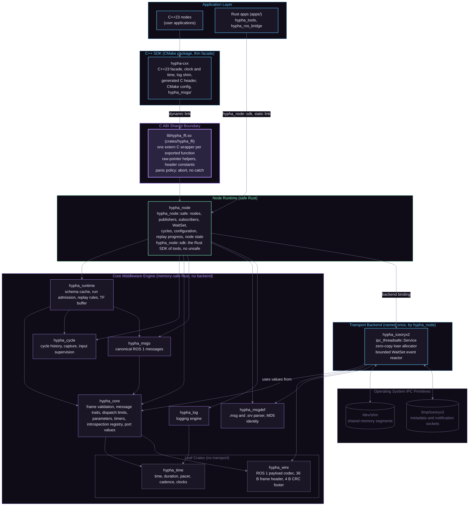

# Software Architecture Specification (SAS)

## 1. Scope and Standards Compliance

This document describes the software architecture of `hypha`, a SIL0 middleware project. It does not claim compliance with or certification against any standard. The following standards are background references only:
- **IEC 61508-3:2010 § 7.4.3** (Software Architecture, background reference)
- **IEC 61784-3** (Functional Safety Fieldbuses: communication errors and the black channel, background reference)

Primary domain: robots and autonomous machines that run their software on one host.

---

## 2. Layering and Boundary Isolation

`hypha` uses a strict layered architecture. Shared logic is kept in the core library.



ROS 1 compatibility covers serialized message payloads. `hypha_wire` provides
the Rust primitive payload codec; the C++ SDK supplies message serialization.
The shared-memory transport wraps these payloads in hypha frames.
The apps' [ROS 1 bridge](../apps/hypha_ros_bridge/README.md)
owns ROS graph integration through XML-RPC and topic transport through TCPROS.

### 2.1 The C ABI Boundary (Shared Delivery Artifact)
- **Unified Delivery Artifact**: `libhypha_ffi.so` is the shared library used by the language bindings. It is not a certified artifact.
- **Zero Framework Logic Above Boundary**: C++ headers (`hypha-cxx`) and Rust clients (`hypha`) are thin shims. They maintain no duplicate executor, integrity, transport-age, timer, or parameter parsing logic.
- **Dynamic Linking**: C and C++ consumer nodes link dynamically against `libhypha_ffi.so` to guarantee artifact integrity. Rust consumers link the runtime statically through the `hypha` crate, so one process holds one runtime.
- **Exact Revision Check**: The root file `abi.revision` sets one ABI revision for the library and the SDKs. The library file name carries it (`libhypha_ffi.so.<revision>`, `libhypha_ffi.<revision>.dylib`). The C++ SDK refuses a library with another revision at start; the Rust SDK is linked with its runtime and cannot mismatch. See [cpp-api.md](cpp-api.md) section 2.1.

The generated C header defines the foreign declaration surface. The generator
`scripts/gen-ffi-header.sh` reads the root file `abi.revision` and writes the
`HYPHA_ABI_REVISION` macro. The file itself is handwritten.

The Rust SDK is the module `hypha_node::sdk`: it calls the safe functions
(`hypha_node::safe`) of the same crate, not the C ABI. Its only hand-written items are the
re-exports and integer constants in `crates/hypha_node/src/sdk/ffi.rs`.
A C signature does not state buffer, ownership or destruction rules, so the
C++ owners, the text readers and the null-handle tests are written by hand.
Section 5.1 lists every generator.

`./check.sh` runs every generator with `--verify`.
The style gate compares C and Rust sizes, alignments, and field offsets.

### 2.2 The crates below the C ABI

Each crate owns one kind of rule. The dependencies run one way, from the C ABI
down.

| Crate | Owns | Depends on |
|---|---|---|
| `hypha_core` | Message traits, frame validation, dispatch limits, parameter parsing, timers, the node introspection rows (typed facts, no text) and the registry that holds them, and the transport values and rules in `hypha_core::port` (topic specs, names, pattern matcher, errors). | the leaf crates (`hypha_time`, `hypha_wire`) and `toml` |
| `hypha_cycle` | Bounded sample history, capture, the held sample, the input verdict, receive counts, input supervision, the queued-work budget, the oldest-first overflow discard, iteration order, output policy and replay fidelity. `#![forbid(unsafe_code)]`. | `std` only |
| `hypha_msgdef` | ROS 1 message definitions: the `.msg` and `.srv` parser, the dependency walk over a set of definitions, the definition-text reader and the MD5 identity rule. The only message parser in the workspace; `hypha_msggen`, the SDK and the tools use it. | `std` only |
| `hypha_runtime` | Schema and identity caches with their lookup health, schema-serving state, the input port table rules, run admission, dispatch budget and execution counters. The replay rules: the upstream hold and its limits, the upstream progress reports, the progress wire contract. The TF buffer of a cycle's TF input (`tf_buffer`). Generic over the `SchemaTransport` and `RunDriver` traits. | `hypha_core`, `hypha_cycle`, `hypha_msgs`, `hypha_wire`, `log`, `transforms` (=2.3.0, MIT, `forbid(unsafe_code)`) |
| `hypha_sys` | The operating-system calls that need `unsafe`, behind safe functions: the SIGINT, SIGTERM and SIGBUS handlers and the process stop flag they set, a read-only file map (`map_read_only`, the player's recording), a child's parent-death signal (`set_parent_death_signal`, the launch supervisor). | `libc`, `nix`, `memmap2` |
| `hypha_node` | The node runtime as safe Rust functions (`hypha_node::safe`): nodes, publishers, subscribers, the `WaitSet`, cycles, configuration, the publishers and subscribers of the replay progress topic, and the node state. The C types of the ABI, which its functions take; the C callbacks reach it as trait objects (`DeliveryHandler`, `IntervalHandler`, `CycleStepHandler`) that `hypha_ffi` builds. It names the backend once and implements `SchemaTransport` and `RunDriver` for it. Its SDK re-exports the two `hypha_sys` calls a tool needs (`hypha_node::sdk::sys`). | all of the above, `hypha_iceoryx2`, `hypha_sys` |
| `hypha_ffi` | The C ABI: one thin `extern "C"` wrapper over a `hypha_node` function for each exported function, the raw-pointer helpers (`boundary.rs`), the owners of the C callbacks (`callbacks.rs`), the cycle handle (`cycle/handle.rs`), the thread check of a `WaitSet` call (`waitset/access.rs`) and the `#define` constants of the header. Panic policy: a Rust panic aborts the process. The shared library `libhypha_ffi`. | `hypha_node`, `hypha_core`, `hypha_log`, `hypha_msgs` |
| `hypha_testing_mcap` | Test only, not below the C ABI: the MCAP reader of the C++ testing component's golden-sample replay (`hypha::testing::McapReplay`). A safe `Reader` (whole file in memory, at most 1 GiB, every CRC checked; channels with type name, encodings and the recorder's `md5sum` metadata; selected topics in log-time order, ties in file order) and a thin C API `hypha_mcap_*` in `src/ffi.rs`, header `include/hypha/testing/mcap_reader.h` (cbindgen, `scripts/gen-mcap-reader-header.sh`). A static library; not in `libhypha_ffi`, and no workspace crate depends on it. | `mcap` (the version and features `hypha_tools` locks), no workspace crate |

- `hypha_runtime` and `hypha_cycle` never name a backend and never depend back
  on `hypha_node`. `hypha_node` never depends on `hypha_ffi`, and contains no
  `extern "C"` function of the ABI.
- `unsafe` is only in `hypha_ffi` (the C boundary, the owners of the C callbacks and
  their contexts, and the cycle handle), `hypha_sys` (the operating-system calls),
  the test-only module `hypha_testkit/src/env.rs` (the tests' wrappers of the
  edition-2024 `unsafe` `std::env::set_var` / `remove_var`) and the C boundary
  module `hypha_testing_mcap/src/ffi.rs` of the test-only MCAP reader. The lint
  levels hold the policy: the workspace sets `unsafe_code = "forbid"`, `hypha_ffi`
  and `hypha_sys` allow it, `hypha_testkit` denies it and `src/env.rs` allows it,
  `hypha_testing_mcap` denies it and `src/ffi.rs` allows it, and `hypha_node` and
  `hypha_tools` forbid it.
- `scripts/check-deps.sh` checks the dependency rules on `cargo metadata`: only
  `hypha_node` depends on `hypha_iceoryx2` and on `hypha_sys`, only `hypha` and `hypha_ffi` on
  `hypha_node`, nothing on `hypha_ffi`, `hypha_testing_mcap` on no workspace crate
  and nothing on it, and a package under `apps/` uses the SDK
  `hypha` alone. `check.sh` runs it, and once more on a forbidden edge it must refuse.
- A `WaitSet` co-owns its node (`Arc<HyphaNode>`), so the node outlives every
  `WaitSet` on it. `hypha_node_destroy` drops the node's default `WaitSet` first,
  because that `WaitSet` holds a share of the node that would otherwise keep it alive.

#### Ownership at the C boundary

The C ABI hands out raw handles, so `unsafe` is at the `extern "C"` entry points:
turning a handle into a reference, reading a caller buffer, writing an out
parameter, taking a `Box` back. `crates/hypha_ffi/src/boundary.rs` holds these
operations, each with its contract stated once (`handle_ref`, `write_out`,
`borrow_str`, `write_text`, ...); an entry point calls them and holds no pointer
arithmetic, cast or null check of its own. An entry point that holds logic is a
thin wrapper around a safe function of `hypha_node` of the same name without the
`hypha_` prefix (`hypha_node::safe`): the function takes references and returns
`Result<_, Error>`, and `From<Error> for HyphaStatus` in
`hypha_node/src/status.rs` is the one mapping to a status. An entry point that
only releases a handle or reads one value has no such function: it drops the
handle or calls the method (`hypha_publisher_destroy`, `hypha_subscriber_destroy`, `hypha_loan_drop`,
`hypha_subscriber_missing_sequences`). A call that takes
ownership receives the `Box` or `Arc` and gives it back with the error, so a
refused call leaves the handle to the caller.
`HyphaWaitSet` is `Send` by its fields, without an `unsafe impl` (a `WaitSet` is not
bound to a thread, and it holds no raw pointer), which makes `HyphaNode` `Send` and
`Sync`. The part another thread may touch during a run (whether it runs, the thread
that runs it, the native stop, the requested failure) is `WaitSetShared`, an `Arc` the
`WaitSet` holds: `hypha_waitset_request_stop` and `_request_failure` reach it through
the raw handle and form no reference to the `!Sync` `WaitSet`, every other call that
names a `WaitSet` or a cycle asks it first and is refused with `InvalidState` there
while the `WaitSet` runs on another thread, and an input source names its `WaitSet` by
a `Weak` of it. The C cycle handle is an `hypha_ffi` struct `{ waitset, id, snapshots }`:
`hypha_cycle_health` and `hypha_cycle_binding` read its `Arc<CycleSnapshots>` alone,
from any thread. A C callback and its context are owned by
an `hypha_ffi` struct whose drop releases the context once. Below the entry points the ownership
graph is safe Rust, and each relationship exists once:

| Owner | Owns | Through |
|---|---|---|
| The caller (C) | `HyphaWaitSet`, `HyphaPublisher`, `HyphaInputSource`, `HyphaLoan` | `Box` handed out by `Box::into_raw`, taken back by the destroy call |
| The caller (C), shared with every `WaitSet` on the node | `HyphaNode` | `Arc` handed out by `Arc::into_raw`; `hypha_node_default_waitset` takes a share (`node::share_node`), so a `WaitSet` reaches its node without a back-pointer |
| The caller (C), shared with a subscription registration or an input source | `HyphaSubscriber` | `Arc` handed out by `Arc::into_raw`; `hypha_waitset_attach` takes a second owner for the registration, `hypha_input_source_create` takes over the caller's owner |
| `HyphaNode` | its default `WaitSet`, the framework subscribers of simulated time | `Mutex<WaitSetSlot>` (the `WaitSet`, lent to one Rust `WaitSetLease` at a time, which gives it back), `Mutex<Option<Box<_>>>` |
| `HyphaWaitSet` | its registrations, then its cycles (declared in that order, so a registration never outlives the cycle it names) | `RefCell<Vec<Registration>>`, `RefCell<Vec<Cycle>>`: every call holds `&HyphaWaitSet`, a run borrows them for its length, and a call from another thread during a run touches only its `Arc<WaitSetShared>` |
| A subscription registration | a share of the subscriber it drains | `Arc<HyphaSubscriber>`, released at the detach or the `WaitSet`'s destruction |
| A registration | the cycle it steps, by id only | `CycleId` (a `u64` from a per-`WaitSet` counter, never zero, never reused): the dispatcher resolves it against the `WaitSet`'s cycle list it holds for the run |
| A C registration or cycle | the caller's callback and context, and for a cycle its C handle `HyphaCycle` | an `hypha_ffi` struct behind `Box<dyn DeliveryHandler>`, `Box<dyn IntervalHandler>` or `Box<dyn CycleStepHandler>`, built only once the attach or create can no longer be refused; its drop releases the context once, after `end_dispatch` for a subscription, and then frees the cycle's handle |
| A cycle (`Cycle`) | its step state, a share of its snapshots | `step: RefCell<CycleStep>`, borrowed for one tick or one configuration call; `Arc<CycleSnapshots>` (name, period, `committed`, the health snapshots behind `Mutex`), shared once with the C handle, is what a step callback or another thread may read meanwhile |
| `CycleStep` | the bound sources, the bound publishers, the TF inputs, the staged emissions | `Vec<Arc<CycleInputSource>>`, `Vec<CycleOutput>` with `Box<HyphaPublisher>` |
| `CycleInputSource` | its receiver and its history | `Option<Arc<HyphaSubscriber>>` (the caller's owner, taken over at creation), `Option<Arc<Mutex<CycleHistory>>>` (the history is shared with every binding that reads the source) |

One back-pointer remains, a C contract rather than Rust ownership: the C cycle handle
holds the address of its `WaitSet`, which owns the cycle and frees the handle with it,
and `hypha_ffi` alone dereferences it. A publisher and a subscriber record the address of the node that created them,
compared and never dereferenced, so a cycle binds only its own node's endpoints and
the types stay `Send + Sync` by construction.

Lending and receiving take `&self`: `Iox2Publisher::loan`, `lend_frame`,
`take_sequence` (an `AtomicU64`), `Iox2Subscriber::try_receive` and
`HyphaSubscriber::receive_validated`. A step therefore shares its outputs as a slice
between the reserve and the dispatch, and a source drains its subscriber through the
`Arc`. The output limits live in `hypha_cycle`: the runtime hands the step an
`EmissionBudget` that admits each message, and `hypha_node` keeps no copy.

A call that needs the step state while a step holds it, such as a configuration
call from inside the step, returns `InvalidState` from `RefCell::try_borrow`; nothing
panics and nothing aliases. `RefCell` rather than `Mutex`: every path to the step runs
on the thread that configures the cycle or runs its `WaitSet`, and the calls another
thread may make on a running `WaitSet` (`hypha_waitset_request_stop`,
`hypha_cycle_health`, `hypha_cycle_binding`) touch only the header, which the step
refreshes after each iteration, or the stop handle.

### 2.3 Where received data is judged

Two stages judge received data, and each rule exists once.

| Stage | Owner | Decides |
|---|---|---|
| Frame acceptance | `hypha_core::frame_validation` | Layout, CRC, schema hash, future send time, publisher sequence. It keeps its own rejection counters. |
| Judgement of an accepted input | `hypha_cycle::capture`, `hypha_cycle::supervision` | Age, the one verdict `Usable`, `Stale` or `NeverArrived` and the `ok` bit (the C++ ports read both as they are), the held sample, receive and delivery counts, the queued-work share and overflow discards, silence and stagnation. |

The C++ SDK judges nothing. A subscriber rejects no frame by age. A cycle judges
age per binding at capture, so ports of one source can use different limits.

The node state is read from the cycles. Each binding has one freshness judgement
at its cycle's last capture: the verdict (usable, also when an Arrivals port had no
new sample; stale; or never arrived), the stale fault and the age come from it, and
the `ok` bit adds the rest (an unwired or advisory input is ok, an ignored one is ok,
else ok means usable and not stagnant). `hypha_node_state` reads the verdict and the
`ok` bit of each input that counts for health; C++ `inputsOk()` reads the same bit.
Bindings of one topic give one input with the worst verdict. The node is `WAITING`
while a binding that never arrived is not ok, else `DEGRADED` while any is not ok:
a stagnant input degrades the node, an ignored stale input does not. `runNode`
publishes the state on `~/state` every second. Each cycle logs every change of a
judgement once, after the step that captured it; reading the state logs nothing.

### 2.4 The layers of the C++ SDK

Each layer uses only the layer below it.

```text
L3  CycleNode + runNode<App>      a class: ports are members, step() is a method
L2  Cycle + ports + step functor   manual composition: any port count, no inheritance
L1  Subscriber, Publisher, Timer, WaitSet, run()    no cycle at all
------------------------------------------------------------------ C ABI
    hypha_node cycle module: create, bind, commit, image, emit, health
    hypha_cycle: history, capture, held value, verdict, counts, supervision
```

| Need | Layer |
|---|---|
| A fixed set of topics, one rate, state in one object | L3 |
| Ports built from a parameter list at run time | L2 |
| Two cycles at different rates that share one state object | L2 |
| Ports in a struct the application already owns, no virtual step | L2 |
| A callback per message, a custom loop, raw or loaned samples | L1 |

L3 adds `setup(Node&)` and `step()`. The shared application
runner owns startup and cycle commit: `runNode` loads the parameter file, constructs the
application, joins the bus, runs `setup()`, starts the cycle, checks that every parameter key
was read, reports the node (manifest, `~/introspection`, `~/state`) and runs. Timer-driven applications use
`ApplicationNode` with the same `runNode` entry point. Everything L3
does is also possible with L2. That rule keeps L3 thin. L1 does not change when a
node uses a cycle.

| Concern | Owner |
|---|---|
| History, capture, held value, verdict, counts, iteration order, output policy | `hypha_cycle` |
| Report fields, held sample, message stamp, handles, the backend | `hypha_node` |
| Typed ports, decode and encode, the step call, application state | `hypha-cxx`. It holds no retention rule, no age rule and no counter. |

Rust has no cycle facade. The failure rules of a cycle are in the
execution model, section 6.3.

---

## 3. Freedom from Interference (FFI) and Safety Barriers

For reliable multi-node applications, the architecture provides:

### 3.1 Spatial Memory Isolation
- Every node runs in an independent operating system process.
- Processes execute in distinct memory spaces protected by hardware Memory Management Units (MMU).
- Pointer corruption or memory safety faults in a perception node cannot overwrite the memory of safety-critical control nodes (FSR-16).

### 3.2 Temporal Isolation
- Hot data paths use non-blocking lock-free queues.
- A stalled or crashed consumer cannot block publishers; unread samples are dropped according to configured queue policies.
- Publication buffer exhaustion returns `HYPHA_STATUS_POOL_EXHAUSTED` immediately without priority inversion.

### 3.3 Panic Policy
- Shipped Rust code denies panics workspace-wide.
- A Rust panic aborts the process (SIGABRT). The release build has `panic = "abort"`; a debug build unwinds inside Rust and aborts where the panic reaches an `extern "C"` entry point. No entry point catches it, so no internal fault is returned as a status. Destructors and log flushes do not run on that path.
- `HYPHA_STATUS_PANIC` reports only a foreign callback that threw (a C++ exception caught by the SDK, or a C callback that returned status 7).

### 3.4 Safety Communication Layer (SCL) and Black Channel Pattern
- The shared memory transport (`iceoryx2`) and host shared memory (`/dev/shm`) are treated as an untrusted **Black Channel** in the sense of **IEC 61784-3**, inside a closed system.
- Every publish-subscribe sample has one fixed format: a frame header (version-specific magic, flags, schema hash, publisher id, sequence, host monotonic send time, framework send time, and a CRC-32C over those fields and the payload, started from a code of the topic so that a frame of another topic fails it) carried as the iceoryx2 user header, next to the message payload. No topic selects an optional profile.
- The ABI validates the header, magic, send time and per-publisher sequence before a sample reaches any callback or accessor. A corrupted, truncated, duplicate, reordered or future-dated frame is refused with an explicit status and counted. A managed cycle input judges transport age per binding at capture. A low-level subscriber does not reject by age (FSR-10). The sequence wraps to zero after its maximum value, and the receiver compares it modulo 2^64, so the wrap is accepted as the next frame in order.
- Every subscriber validates the header and payload, diagnostic tools such as the `hypha record` MCAP logger included. The publisher computes the CRC once per send; the receiver checks it once per receive.
- A refused frame is also logged: at most one warning per subscriber per second (`refused a frame: <reason>; <n> more refused since the last report`), next to the `integrity.*` counters.
- **What the CRC proves, and the trust boundary.** The CRC proves the bytes between `publishLoan` and validation. It does not prove them before or after:
  - *Before sealing.* `seal()` (`crates/hypha_wire/src/frame.rs`) certifies whatever the loan holds when it is sent. A loan changed while its publisher fills it carries a valid CRC over the changed bytes.
  - *After validation.* Delivery is zero-copy: a callback, a raw sample and an owning sample read the payload where the publisher wrote it. A change there after the check is not detected. A cycle input copies the payload into its history right after the check, so its window is that copy.
  - Only the publisher process and processes outside hypha can make either change. iceoryx2 maps a publisher's data segment read-only in every subscriber (`AccessMode::Read`), so another hypha node cannot write it. A writer is therefore the faulty publisher itself, or a process that runs with the domain's UID (or as root) and opens the segment files. Such writers are inside the trust boundary: give the domain's shared memory only to hypha processes, under one dedicated UID (`docs/engineering-traps.md`, containers).
  - *What enforces the boundary.* Only file permissions do. iceoryx2 creates its segments as named files readable and writable by their owner. The read-only mapping is the subscriber's own choice, not a lock on the file: any process with the domain's UID can open `/dev/shm/iox2_*.data` for writing. The container study's corruptor does exactly that, from a plain Python process. iceoryx2 uses no file seals, and a write seal could not help: it would also stop the publisher, which writes into its loans. The connection segments are writable by every participant by design, because a subscriber returns its samples through them. A domain therefore needs one UID (enforced by `preflight.rs`), and one UID is one trust domain. Nothing inside the operating system separates one thread of the publisher from another before `seal()`.
  - *Faults, not attacks.* The CRC detects accidental change. A deliberate writer with the domain's UID recomputes it. A keyed MAC does not help against that writer either: it can usually read the key from the publisher's memory (`ptrace`, `/proc/<pid>/mem`). This is the closed-system assumption: a system whose access control keeps unauthorised writers out. Protection against a hostile writer inside the boundary would need a separate UID per role and a transport in which subscribers write no shared state; iceoryx2 0.10 provides neither.
  - An application that needs end-to-end protection against them computes its own checksum while it fills the payload and checks it on receipt. hypha adds no copy for this case: the container study measured it only under deliberate high-rate corruption of shared memory.

---

## 4. Inter-Process and Inter-Subsystem Communication

### 4.1 Intra-Host Bus (Shared Memory)
- **Transport**: `iceoryx2` configured with `ipc_threadsafe::Service`.
- **Zero-Copy Payload Loans**: Publishers loan pre-allocated shared-memory buffers, populate payloads in place, and send. Subscribers loan and read data directly in shared memory.
- **Fixed Bounded Capacities**: Buffer sizes, queue depths, and loan limits (maximum 8 concurrent samples) are bounded at service creation.

### 4.2 External Network Boundary
- The transport is single-host. This repository contains no network protocol code.
- A network protocol runs in a separate bridge process that uses the C++ or Rust SDK. The ROS 1 bridge (XML-RPC and TCPROS) is in `apps/`.
- A bridge process keeps network stacks out of the processes that use the shared-memory bus.
- A bridged message gets its transport send stamp when the bridge publishes it. Its transport age therefore starts at the bridge. A node that needs the age at the source reads the message header stamp.

---

## 5. Modular Build and Integration Architecture

The repository provides modular, separable CMake and Cargo build units:

| Unit | Language / Build System | Role |
|---|---|---|
| `crates/hypha_log` | Rust (Cargo) | Logging engine and backend of the `log` crate facade: validates the `[log]` table, renders lines, writes the console and rotating file sinks. Creates no thread. Rust crates log with `log` macros, and `hypha_iceoryx2`'s internal logs arrive at `Warn` and above. Depends on `hypha_time`, `toml`, `log` and `rustix`, has no `unsafe` and uses the file system, so it is not a leaf crate. `hypha_core` keeps the `[log]` table as plain TOML and depends on no logging code; node creation hands the table to the engine, and the framework's own diagnostics go through the same engine. |
| `crates/hypha_node` | Rust (Cargo) | The node runtime as safe Rust functions; the C types of the ABI. |
| `crates/hypha_ffi` | Rust (Cargo) | Exports the C ABI as wrappers over `hypha_node`. Produces the shared library, versioned by `abi.revision`: `libhypha_ffi.so.<revision>` on Linux and `libhypha_ffi.<revision>.dylib` on macOS. |
| `crates/hypha_msggen` | Rust (Cargo) | Generates C++ and Rust types from ROS 1 `.msg` and `.srv` files. Installed with the SDK for consumer code generation. |
| `crates/hypha_msgs` | `.msg` + CMake | Canonical ROS 1 message definitions. Generates the `hypha_msgs/` headers into the build tree; installs nothing itself. |
| `crates/hypha-cxx` | C++23 (CMake) | The one C++ package, `find_package(hypha)`. Installs `libhypha_ffi.so` and its generated header `hypha_ffi.h`, the `hypha_base` clock and time headers (sources in `crates/hypha-cxx/base`), the user-facing C++ SDK facade and the `<hypha_log/hypha_log.h>` macro shim. Owns and installs the whole `hypha_msgs/` include namespace. |

### Building hypha

The root CMake project drives cargo and builds every unit together. An
application uses it in one of two ways: it adds the hypha source tree to its own
CMake project (FetchContent or `add_subdirectory`, in the `hypha-builder` image),
or it uses `find_package(hypha)` on a prefix that `cmake --install` filled. As a
subproject, hypha keeps its strict warnings to its own targets.

`hypha-cxx` owns the complete `hypha_msgs/` include namespace. It writes
`ros_time.h` by hand and installs the generated message headers beside it,
because its own `ros/serialization.h` includes them.

The same package installs what an application needs to generate its **own**
messages: the generator binary, the canonical `.msg` definitions under
`<prefix>/share/hypha/msg`, and the `hypha_generate_messages()` CMake function
in `hyphaMessages.cmake`. One call declares one named package:
`hypha_generate_messages(PACKAGE app_msgs MSG_DIR <dir> DEPENDS std_msgs)`
creates the INTERFACE target `app_msgs`. The directory is read flat, and its
name carries no meaning. An application message that names `std_msgs/Header`
needs that field's definition, not its header — the generator computes the
nested layout and identity from the definition text. Installing the headers
alone would leave an application able only to reach into a hypha source
checkout, which no install prefix has.

`./test.sh cpp` tests both ways: `scripts/test-installed-sdk.sh` against an
install prefix, and `test/package_consumer` with hypha as a subproject.

### 5.1 Generated files

`./check.sh` runs each generator with `--verify` and fails on a generated file that a
person edited or that the source left behind; the header itself carries no banner.

| Generator | Reads | Metadata | Writes |
|---|---|---|---|
| `scripts/gen-ffi-header.sh` | The `hypha_ffi` and `hypha_node` Rust sources, through `cbindgen` | `crates/hypha_ffi/cbindgen.toml` | `crates/hypha_ffi/include/hypha/hypha_ffi.h` |

A generator never infers a buffer rule, a nullability rule, an ownership
transfer or a destruction order from a C signature. No generator runs at
application run time, and none adds a runtime artifact.

The C++ handle owners and text readers are hand-written, with no generator.
`crates/hypha-cxx/include/hypha/backend/handles.h` holds:

- `UniqueHandle<T>`, a move-only owner with `get`, `release`, `reset` and `put`.
- One release rule for each handle that has one destroy call: `HyphaConfig`,
  `HyphaLoan`, `HyphaPublisher`, `HyphaSubscriber` and `HyphaWaitSet`. The destroy function of `HyphaWaitSet`
  returns a status, and the owner logs a refusal.

`text_readers.h` holds the `std::expected` text readers. Each reader owns its
output buffer and returns the text, or the status that the C ABI returned. The
`grow` readers start with a fixed buffer and retry once with the length that the
C ABI reports. The `size_query` readers ask for the size, copy, and try twice.

`crates/hypha_ffi/tests/argument_preamble.rs` holds the null-handle tests: one row
for each exported function that returns `HyphaStatus`. Each row passes a null handle and expects
`InvalidArgument`. Output integers and output handles are valid. Every other
argument is null, zero or `None`. A test therefore shows the refusal, not that
the handle check runs before the other checks. Other tests in `crates/hypha_ffi/tests`
cover a null output with a valid handle, a function that returns no status, and
the destroy of null.

### 5.2 What stays handwritten

Each C handle of the C++ SDK has a release rule in `handles.h`, has a handwritten
owner, or is borrowed. The table gives the reason for each handwritten and
borrowed handle.

The C ABI has no owning receive: only the Rust SDK keeps a sample after the
callback (`RawSubscriber::try_receive`), through the safe functions of `hypha_node`.

| Handle or class | Mode | Reason |
|---|---|---|
| `HyphaNode` | handwritten | The session shuts the node down before it destroys it, and only after the cycles are released. |
| `HyphaCycle` | handwritten | A failed destroy keeps the cycle and stops the shutdown. The registry reports the status. |
| `HyphaInputSource` | handwritten | A failed destroy is logged to standard error. A shared holder owns the source. |
| `HyphaCycleImage`, `HyphaCycleEmission` | borrowed | The cycle owns them for one call. The C ABI has no destroy function. |
| `SubscriberHandle`, `TimerHandle` | handwritten | They are not C handles. They detach the executor registration before they free the shared state. |

Other readers stay handwritten when their input or output is a byte buffer
(`introspect`) or has more than one output buffer
(`hypha_cycle_bind_input_supervision`). A new handle type that owns an attachment
detaches it before it gives up its state, as `SubscriberHandle` does.

### 5.3 Size budgets

| Budget | Limit | Enforced by |
|---|---|---|
| C++ header | 400 lines | `./check.sh` |
| Line coverage of each required Rust crate | 80% | `scripts/coverage.sh` |

A line count shows where to look. It does not measure design quality. Moving
code does not reduce it, and generated code still counts as source. The project
sets no test-to-source ratio and no deletion quota. Do not split a cohesive type
only to meet a line limit.

### 5.4 Rules that keep the code lean

1. One owner for each rule. Age, retention, freshness, timers, parameter parsing
   and supervision exist once, below the C ABI.
2. No cache, mutex, loan counter or limit above the C ABI that repeats a rule
   the library already enforces. A language facade keeps decoded objects and
   their lifetimes, nothing more.
3. Every public symbol, parameter and ABI export has an observable purpose and a
   requirement owner. An unused application caller alone does not show that a
   library capability is dead. Audit the SDKs, tools, examples, documents and
   generated code before you delete a public API.
4. A new mechanism replaces the old one in the same change. No shim or alias
   stays.
5. Add a CMake target only when it carries a distinct build requirement. Two
   interface targets that link the same shared library cannot exclude its cycle
   runtime.
6. Test support lives in `crates/hypha_ffi/tests/common/`. A fixture destroys
   only the resources it owns, in dependency order. It never wipes machine-wide
   shared memory. Keep the tests that need separate process state or a separate
   translation unit, such as the logging module tests.
7. Remove an assertion only when a retained test demonstrably covers the same
   behaviour.

## 6. Design Decisions

| Decision | Reason |
|---|---|
| Supervision belongs to the input port, not to a separate object. | The port already owns the history, the counts and the verdict. A separate link object with its own states and limits repeated them. |
| Disabled and ignored are separate facts. | Disabled is configuration (an `Optional` port with an empty or unset `topic`). Ignored is a runtime override that hides the condition: `stale()` and `stagnant()` are false while a port is ignored, and `ignored()` shows the override. |
| The node state is judged from the cycle's capture. | The capture judges an input once. The node state reports that verdict and judges nothing itself. |
| One limit decides freshness and the fault. | `silence_ms`, measured from each sample's send time, gives both the `Stale` verdict and `stale()`. Two limits that mostly agree were hard to tell apart, and a late sample counted as alive under an acceptance timer. |
| Stagnation needs an alive counter from the payload. | The frame sequence advances when a stuck sender publishes the same payload again. Only the payload shows that its logic is stuck. |
| The log throttle counts host monotonic time. | It bounds console and disk bandwidth, which the host consumes in host time. Host time never goes back, and a paused or jumping simulated clock does not change it. |
| The log engine creates no thread. | The framework creates no thread. A write runs on the thread that logs and is not buffered, so a crash loses no written line. The cost is that a slow disk delays that thread. |
| Schema resolution in a callback. | A lookup waits for an RPC round trip, and the calling thread delivers the answer, so a dispatcher callback gets `InvalidState`. The Rust SDK's `BusNode::resolve_schema_hash` always refuses there. `hypha_schema_lookup` is the one exception: it returns a definition the node already holds. Resolve the schema before the run. |
| Age is judged at capture, per binding. | A subscriber that rejects by age cannot serve two ports with different silence limits. |
| The cycle runs due timers before it dispatches ingress. | Continuous ingress cannot postpone timer work. The price is a phase delay and no deadline guarantee. |
| The held sample lives below the C ABI. | The C++ SDK then keeps no retention rule. A `Latest` port has no value before the first sample, and `has()` says so. |
| The output default is to fail the run. | The framework never invents a safe command. A `diagnostic` output, which drops a send that finds the pool exhausted, is an explicit choice. |
| `CycleNode` is the one model for a cyclic node. | One model replaces the old builder. The builder, its records, `Node::cycle`, `hypha_cycle_describe`, `hypha_node_describe_text` and the untyped subscriber constructor no longer exist. |
